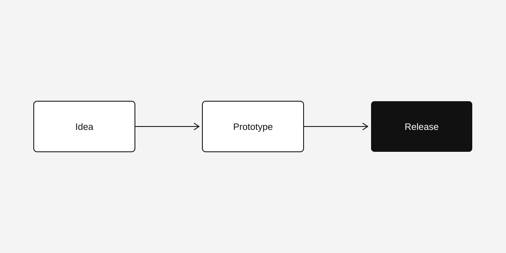

Das ist ein Beispielbeitrag. Er zeigt das Artikel-Layout mit Abschnitten, einer Tabelle, einer Abbildung, einem Zitat und einem Codeblock. Das Inhaltsverzeichnis links folgt deiner Position auf der Seite.

## Was dieses Template mitbringt

Jeder Beitrag ist eine Markdown-Datei. Der Build macht daraus eine statische Seite. Es braucht keine Datenbank und keinen Servercode, also kann jeder Webspace das Ergebnis ausliefern.

Leser wählen ein Design, eine Schriftgröße, eine Seitenbreite und eine Schriftart. Die Seite merkt sich die Auswahl im Browser.

## So ist ein Beitrag aufgebaut

Jeder Beitrag beginnt mit einem kleinen Block an Feldern:

```yaml
title: Mein Beitrag
description: Ein Satz für Listen und Suchmaschinen.
date: 2026-10-26
tags: [tooling]
series: example-series
part: 3
featured: true
```



### Serien

Eine Serie fasst kurze Beiträge zu einem Thema zusammen. Jeder Teil verlinkt die anderen Teile. Die [Serienseite](/de/series/example-series/) listet alle Teile in Reihenfolge.

### Übersetzungen

Eine Datei mit gleichem Namen in einem anderen Sprachordner ist die Übersetzung. Ohne Übersetzung sieht der Leser den Originaltext und einen kurzen Hinweis.

## Vergleich

| Element | Zweck | Beispiel |
| --- | --- | --- |
| Beitrag | Ein Artikel | Diese Seite |
| Serie | Ein Thema in Teilen | Beispielserie |
| Thema | Ein Tag über Beiträge hinweg | meta |

## Wie es weitergeht

> Erst die kleine Version veröffentlichen, dann verbessern.

Der nächste Schritt sind echte Inhalte. Lösche die Beispielbeiträge, sobald deine eigenen online sind.
